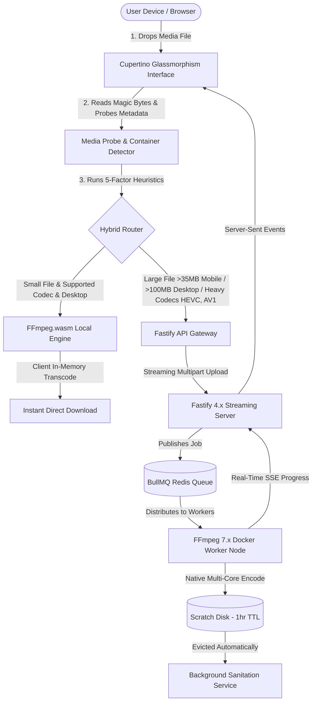

# 🎬 Universal Media Converter

[](https://turbo.build)
[](https://developer.apple.com/design/)
[](https://ffmpeg.org)
[](#security--command-sanitization)

> **Universal Media Converter** is an enterprise-grade, high-performance media transcoding, compression, and editing studio. Designed around Apple's Cupertino glassmorphism design language, it seamlessly pairs client-side **WebAssembly** with a high-throughput **Fastify + BullMQ + native FFmpeg 7.x** cloud cluster.

---

## 🏛️ System Architecture



---

## ✨ Core Highlights & Studios

### 1. 💎 Cupertino Glassmorphism Design System
- Built to match Apple's iOS/macOS human interface guidelines.
- Specular highlights, translucent backdrop blurs (`backdrop-filter: blur(20px) saturate(180%)`), hairline border refraction, and mouse-following spotlight gradients.
- Spring physics animations powered by Framer Motion (`stiffness: 420, damping: 30, mass: 0.8`) with 60fps GPU acceleration and complete reduced-motion fallback.

### 2. ⚡ Hybrid Conversion Engine
- **Client-Side WebAssembly (`FFmpeg.wasm`)**: Zero server latency, 100% offline-capable, complete privacy for sensitive media.
- **Cloud Turbo Cluster (`FFmpeg 7.x`)**: Automatic routing for high-complexity encoding (H.265/HEVC, AV1, Apple ProRes) and large files (>35MB on mobile, >100MB on desktop) to prevent browser WebKit memory exhaustion.

### 3. 🗜️ Target Size Compressor
- One-click file size targeting for platforms with strict upload limits:
  - **Discord**: 25MB preset with automatic video/audio bitrate allocation.
  - **WhatsApp**: 16MB preset optimized for mobile messaging.
  - **Email**: 10MB preset with high compression efficiency.
- Interactive split before/after visual comparison slider.

### 4. ✂️ Sub-Frame Timeline Video Editor
- Frame-accurate video trimming with sub-second precision.
- Interactive scrub timeline, playback rate adjustment (0.5x, 1x, 1.5x, 2x).
- Keyboard shortcuts: `Space` (Play/Pause), `J` (Reverse/Back), `K` (Pause), `L` (Forward), `I` (Set In-Point), `O` (Set Out-Point).

### 5. 📦 Batch Queue Studio
- Multi-file bulk conversion with sequential or parallel processing.
- Independent format and preset configuration per item.
- Automatic bundling into a unified `.zip` archive upon completion.

### 6. 🎵 Audio-to-Video Visualizer Studio
- Turn podcasts, voice notes, and music tracks into 1080p social videos.
- Dynamic HTML5 Canvas visualizer animations: **Bars**, **Wave**, **Circle Pulse**, **Audio Spectrum**.
- Curated atmospheric themes: **Midnight**, **Cyberpunk Glow**, **Sunset Horizon**, **Aurora Borealis**, **Obsidian**.
- Native aspect ratios: `16:9` (YouTube/Landscape), `9:16` (TikTok/Reels/Shorts), `1:1` (Instagram Feed), `4:5` (Social Portrait).

### 7. 📱 PWA & Multilingual Localization
- Installable Progressive Web App with offline service worker asset caching.
- Native multi-language support (`@universal/i18n`): English (`en`), Spanish (`es`), Arabic (`ar` with RTL layout), Hindi (`hi`), Malayalam (`ml`).
- Persistent local history manager with privacy-first purge controls.
- Dedicated Cluster Telemetry & Worker Health admin dashboard.

---

## 📂 Monorepo Structure

```
UniversalMediaConverter/
├── apps/
│   ├── web/               # Next.js 15 PWA frontend with Cupertino UI
│   ├── api/               # Fastify 4.x high-throughput streaming API
│   ├── worker/            # Dockerized FFmpeg 7.x BullMQ worker
│   └── admin/             # Cluster telemetry & worker health dashboard
├── packages/
│   ├── ui/                # Apple glassmorphic design system components
│   ├── conversion-core/   # Hybrid router, media probe, wasm & cloud engines
│   ├── format-registry/   # Audio/video codec specifications & presets
│   ├── job-contracts/     # Typed Zod schemas for jobs and SSE events
│   ├── config-tailwind/   # Tailwind CSS v4 tokens and glass utilities
│   ├── tsconfig/          # Shared TypeScript base configs
│   └── i18n/              # Multilingual dictionary & localization hook
├── docs/                  # Architecture, design system & motion specs
├── docker-compose.yml     # Multi-container orchestration
└── package.json           # Turborepo root workspace
```

---

## 🚀 Quick Start Guide

### Option A: Run with Docker Compose (Recommended)

Start the entire stack (Redis, Fastify API, FFmpeg Worker, Next.js Web) with a single command:

```bash
docker compose up -d
```

- **Web Application**: [http://localhost:3000](http://localhost:3000)
- **Fastify API Server**: [http://localhost:4000/api/health](http://localhost:4000/api/health)
- **Admin Dashboard**: [http://localhost:3001](http://localhost:3001)

### Option B: Local Development

1. **Install Dependencies**:
   ```bash
   pnpm install
   ```

2. **Start Redis Broker**:
   ```bash
   docker run -d -p 6379:6379 --name media-redis redis:7-alpine
   ```

3. **Start All Services in Parallel**:
   ```bash
   pnpm dev
   ```

---

## 🧪 Testing Suite

Run the high-speed unit test suite (covering hybrid router heuristics, magic byte file signatures, and FFmpeg command sanitization):

```bash
npm test
```

### E2E Testing with Playwright
Run end-to-end integration tests across Chromium and Mobile Safari:

```bash
cd apps/web
npx playwright test
```

---

## 🛡️ Security & Command Sanitization

- **Zero Shell Injection Guarantee**: `SafeFFmpegCommandBuilder` constructs argument arrays with strict regex whitelisting for codecs and numeric boundaries for CRF, FPS, bitrates, and channels. Semicolons, pipes, backticks, and shell expansions are strictly neutralized.
- **Magic Byte Validation**: `detectMagicBytes` inspects real binary headers (`ftyp`, `EBML`, `RIFF`, `ID3`, `OggS`, `fLaC`, `GIF89a`), preventing malicious payload execution disguised via file extension spoofing.
- **Ephemeral Storage Auto-Eviction**: Scratch disk spaces are automatically purged on a 1-hour rolling TTL, ensuring zero persistent retention of user media files.
- **COOP/COEP Headers**: Enforces `Cross-Origin-Opener-Policy: same-origin` and `Cross-Origin-Embedder-Policy: require-corp` to securely enable `SharedArrayBuffer` for multithreaded client-side WebAssembly execution.

---

## 📄 License
MIT © Muhammed Asad & Universal Media Converter Team
